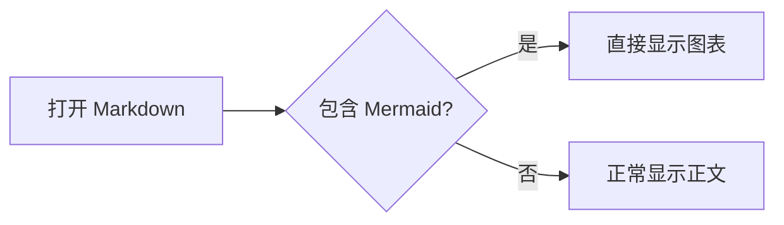
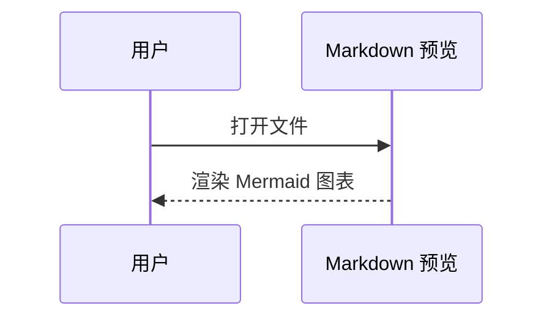

# Markdown + Mermaid

普通 Markdown、**加粗**、表格和代码块仍由内置渲染器输出。

## 流程图



## 时序图



## 引用里的图表

> 增强器只看代码块本身，所以嵌在引用、列表里的围栏同样会变成图表：
>
> ```mermaid
> graph TD
>     Q[引用内] --> R[也能渲染]
> ```

| 功能 | 状态 |
| --- | --- |
| 图表 | 自动渲染 |
| 源码 | 可展开查看 |
| 非 mermaid 围栏 | 保持代码形态 |

```js
console.log('普通代码块照常有高亮和复制按钮');
```

## 应当保持代码形态

用 `text` 围栏写的 Mermaid 源码不会被替换：

```text
flowchart LR
    A --> B
```

## 错误降级

以下故意写错，用来验证错误不会影响正文：

```mermaid
not-a-valid-diagram
```

**本段仍应正常显示。**
